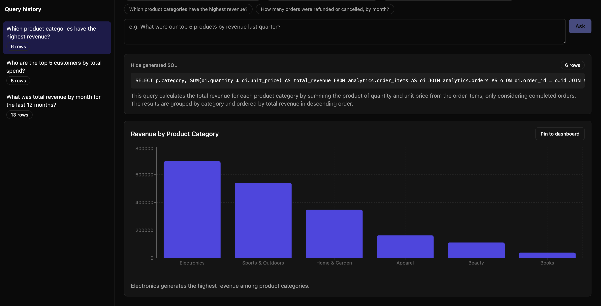
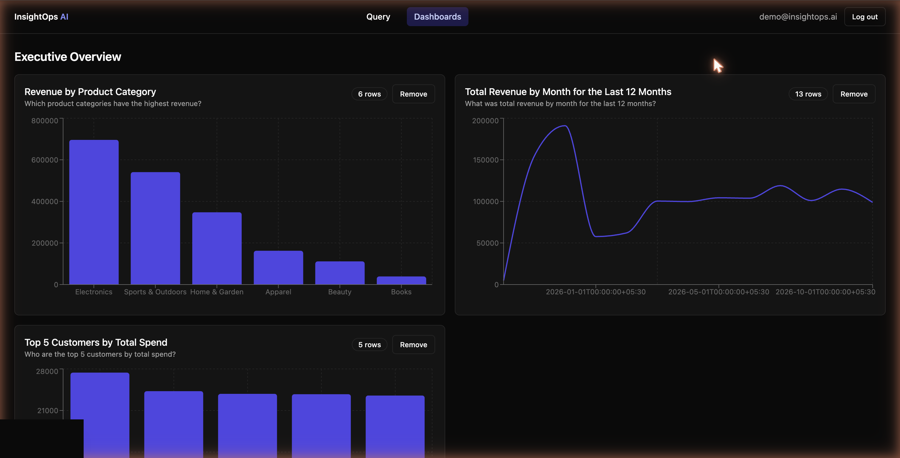

# InsightOps AI — Enterprise Analytics Engine

An analytics platform where you describe what you want to know in plain English, and the system
generates optimized SQL, executes it against a real database, and renders a chart. Built with a
Python/FastAPI backend using LangChain for query generation and Next.js for the interactive
dashboard.

Every screenshot below is from a real local run against a live OpenAI key — real LangChain
structured-output calls, real generated SQL, real PostgreSQL execution, real charts. Nothing here
is mocked.

## Demo

**Ask a question, get SQL + a chart** — the generated query and plain-English explanation are
always shown, never hidden:



**Live dashboards** — pin any query result to a dashboard; widgets re-run their SQL on every load,
so the numbers are never stale:



## Why this is harder than it looks

Letting an LLM write and execute arbitrary SQL against a real database is a genuine security
problem, not a demo footnote. This project treats it that way:

- **A database role that cannot write, enforced by Postgres itself.** The query engine connects
  as `analytics_readonly`, a role with `SELECT`-only grants on a single schema (see
  `backend/db-init/01-init.sql`). This holds even if every line of application code has a bug.
- **An application-level SQL validator that walks the whole parse tree, not just the top-level
  statement.** PostgreSQL allows data-modifying CTEs — `WITH x AS (DELETE FROM t RETURNING *)
  SELECT * FROM x` is a single statement whose outer shape is a harmless-looking `SELECT`. The
  validator (`backend/app/services/sql_safety.py`, built on `sqlglot`) walks every node in the
  parsed tree, rejects statement stacking, rejects cross-schema references, and blocks a denylist
  of dangerous functions (`pg_sleep`, `dblink`, `pg_read_file`, ...). This is tested directly: see
  `backend/tests/test_sql_safety.py`, including a test that specifically proves the
  data-modifying-CTE attack is caught.
- **Automatic row limits**, injected or clamped server-side regardless of what the model asks for.
- **A bounded self-correction loop**, not infinite retries: if the generated SQL fails to execute
  (e.g. a slightly wrong column name), the database's own error is fed back to the model exactly
  once before giving up with a clear error.

## Architecture

```
┌──────────┐   HTTP/JSON    ┌─────────────┐   LangChain structured    ┌─────────────────┐
│ Next.js  │ ─────────────▶ │   FastAPI   │ ────────────────────────▶ │   OpenAI model   │
│ + Recharts│ ◀───────────── │     API     │ ◀──────────────────────── │ (SQL + chart-spec│
└──────────┘                 └──────┬──────┘      structured output   │  generation)     │
                                     │                                 └─────────────────┘
                     ┌───────────────┴────────────────┐
                     ▼                                 ▼
          ┌─────────────────────┐          ┌──────────────────────────┐
          │  `app` schema        │          │  `analytics` schema       │
          │  (full-access role)  │          │  (analytics_readonly role)│
          │  users, saved_queries│          │  customers, products,     │
          │  dashboards, widgets │          │  orders, order_items      │
          └─────────────────────┘          └──────────────────────────┘
                     one PostgreSQL database, two schemas, two roles
```

- **NL → SQL** (`backend/app/services/nl_to_sql.py`) — introspects the `analytics` schema
  (`schema_introspection.py`), builds a schema-grounded prompt, and calls
  `ChatOpenAI.with_structured_output(SqlGeneration)` via LangChain's LCEL (`prompt | llm`) to get
  back a typed `{sql, explanation}` object — no regex-parsing of free-text model output.
- **SQL safety** (`sql_safety.py`) — validates and rewrites the generated SQL before it ever
  reaches the database (see above).
- **Execution** — runs against the read-only role with a `SET LOCAL statement_timeout` (so it
  can't leak into the next pooled connection) and a row cap.
- **Chart selection** (`chart_spec.py`) — a second structured-output call picks a chart type and
  axis mapping from the actual result columns; falls back to a deterministic heuristic if the LLM
  is unavailable or proposes a column that doesn't exist in the result set.
- **Dashboards** — a pinned widget stores the question + SQL + chart spec, not the result rows.
  Opening a dashboard re-executes every widget's SQL live.

## Tech stack

| Layer      | Choices |
|------------|---------|
| Frontend   | Next.js (App Router), TypeScript, Tailwind CSS, TanStack Query, Recharts |
| Backend    | Python, FastAPI, SQLAlchemy (async), LangChain (`langchain-core` + `langchain-openai`) |
| Database   | PostgreSQL — two schemas (`app`, `analytics`), two roles (full-access, read-only) |
| AI         | OpenAI via LangChain structured output (SQL generation + chart-spec generation) |
| SQL safety | `sqlglot` — full parse-tree validation, not string matching |
| Infra      | Docker, Docker Compose, GitHub Actions |

## Project structure

```
backend/
  db-init/01-init.sql     Creates the `analytics` schema and the read-only role + grants
  app/
    services/
      nl_to_sql.py          Schema-grounded SQL generation + execution + self-correction
      sql_safety.py         Parse-tree SQL validator (the security-critical module)
      chart_spec.py         LLM chart-type/axis selection with a deterministic fallback
      schema_introspection.py  Reflects the analytics schema via the read-only connection
    routers/                auth, query (ask/history/rerun), dashboards (+ widgets)
    seed/                   Realistic ~2-year e-commerce dataset generator (Faker-based,
                             seasonal order volume, growth trend)
  tests/
    test_sql_safety.py       The attack-scenario test suite (stacking, data-modifying CTEs,
                              dangerous functions, cross-schema access, limit clamping)
    test_schema_and_readonly_role.py  Proves the DB role genuinely can't write (integration-level,
                              not just unit-level)
frontend/
  app/(app)/query/          Ask-a-question workspace: history sidebar, SQL transparency panel,
                             chart, pin-to-dashboard
  app/(app)/dashboards/      Dashboard list + live widget grid
  components/query/ChartRenderer.tsx  Renders bar/line/area/pie/table from a chart spec
```

## Getting started

### Option A: Docker Compose (recommended)

```bash
cp .env.example .env
# edit .env: set JWT_SECRET_KEY and OPENAI_API_KEY
docker compose up --build
```

- API: http://localhost:8000
- Web: http://localhost:3000

Then seed the sample analytics dataset:

```bash
docker compose exec backend python -m app.seed.seed
```

This generates ~320 customers, 42 products, and ~2 years of orders with realistic holiday
seasonality and a growth trend — enough signal for "revenue by month", "top customers", or
"average order value by segment" to have genuinely interesting answers.

Without `OPENAI_API_KEY` set, the app still runs fully — auth, dashboards, and schema browsing all
work — but `/api/query` returns a clear "not configured" message (HTTP 422) instead of a generic
failure.

### Option B: Run locally

**Backend** (requires PostgreSQL reachable at `DATABASE_URL`):

```bash
cd backend
python3.12 -m venv .venv && source .venv/bin/activate
pip install -r requirements.txt
psql -h localhost -U <your-pg-user> -d insightops -f db-init/01-init.sql   # one-time
python -m app.seed.seed                                                    # one-time
uvicorn app.main:app --reload
```

**Frontend:**

```bash
cd frontend
npm install
npm run dev
```

### Running tests

```bash
cd backend
source .venv/bin/activate
python -m pytest -v
```

27 tests, all against a real PostgreSQL instance (no mocks for the database layer) — auth, the
full SQL-safety attack suite, and a direct proof that the read-only role rejects writes.

```bash
cd frontend
npm run lint
npm run typecheck
npm run build
```

## Known simplifications

Scoped as a working MVP, not a production SaaS:

- Single demo dataset (the e-commerce schema) — connecting to an arbitrary customer database would
  need per-connection role provisioning, not hardcoded here.
- Query result rows aren't persisted; dashboard widgets always re-run live. Good for freshness,
  means a widget breaks (gracefully, shown as an empty chart) if its underlying data is deleted.
- No per-user spending caps on OpenAI usage.
- No live deployment — this ships as Docker images + CI; hosting is left to the deployer.

## License

MIT
